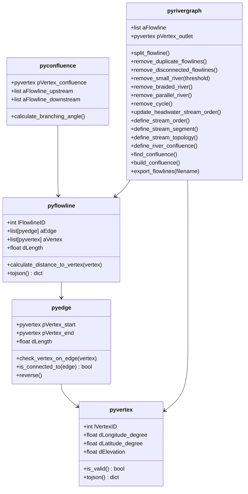
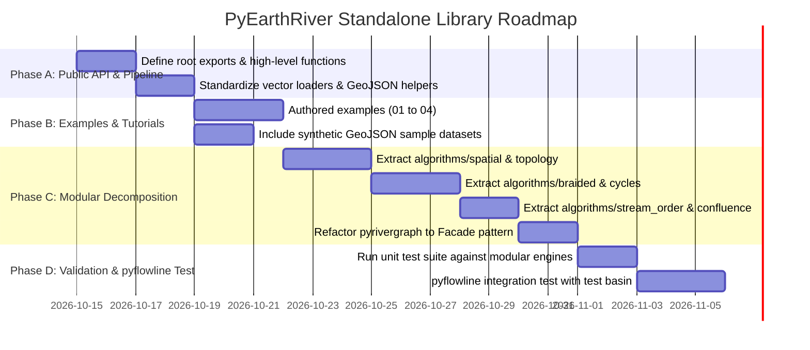

# PyEarthRiver: Standalone Library Architecture & API Roadmap

This document outlines the comprehensive roadmap to transition **PyEarthRiver** into a self-contained, production-grade library suitable for consumption by **`pyflowline`**, hydrological routing engines (e.g., MOSART, MPAS-River), and general GIS/scientific workflows.

---

## 1. Executive Summary & Goals

1. **Provide a Stable Public API**: Guarantee a stable interface for `pyflowline` and external users, preventing breakage when internal algorithms evolve.
2. **Decompose the Monolithic `pyrivergraph.py`**: Refactor the ~2,300-line monolith into cohesive, single-responsibility algorithm modules while preserving `pyrivergraph` as a unified facade.
3. **First-Class Examples & Tutorials**: Add runnable scripts under `examples/` demonstrating toy networks, braided river cleaning, stream ordering, and end-to-end integration workflows.
4. **Comprehensive Data Models & I/O**: Ensure seamless interoperability with vector formats (GeoJSON, ESRI Shapefile, GeoPackage) and GeoPandas / Shapely / NetworkX data structures where applicable.

---

## 2. API Surface Requirements

### 2.1 The pyflowline Contract (Upstream Dependency Requirements)

To cleanly replace the internal copy in `pyflowline`, `pyearthriver` must guarantee the following class and method surface:



### 2.2 Top-Level Public Interface (`pyearthriver/__init__.py`)

Users and downstream packages should import everything they need directly from the root namespace:

```python
from pyearthriver import (
    # Core Domain Classes
    pyvertex,
    pyedge,
    pyflowline,
    pyconfluence,
    pyrivergraph,

    # High-level Pipeline Convenience Functions
    condition_river_network,
    compute_strahler_stream_order,

    # I/O Formats
    export_flowline_to_vector,
    export_vertex_to_vector,
)
```

---

## 3. Modular Architecture Refactor

Currently, `pyrivergraph.py` contains 2,300 lines combining graph construction, spatial index maintenance, topological pruning, and stream ordering. 

We will transition to a **Modular Engine + Facade Pattern**:

```
pyearthriver/
├── __init__.py                  # Root public API
├── classes/                     # Core Tier 1 Primitive Classes
│   ├── __init__.py
│   ├── vertex.py
│   ├── edge.py
│   ├── flowline.py
│   ├── confluence.py
│   └── rivergraph.py            # High-level Facade delegating to algorithms/
├── algorithms/                  # Core Tier 2 Domain Engines
│   ├── __init__.py
│   ├── spatial/                 # Spatial indexing & geometric search
│   │   ├── __init__.py
│   │   ├── indexing.py          # Unified Cython / pure-Python EAFP dispatcher
│   │   └── geometry.py          # Line intersections, vertex-on-edge tests
│   ├── topology/                # Graph structure operations
│   │   ├── __init__.py
│   │   ├── segmentation.py      # split_flowline, merge_flowline
│   │   ├── pruning.py           # remove_duplicate, remove_small, remove_disconnected
│   │   └── connectivity.py      # adjacency matrix, source/sink detection
│   ├── braided/                 # Braided channel algorithms
│   │   ├── __init__.py
│   │   ├── braided_detector.py  # Identifying parallel loops
│   │   └── braided_resolver.py  # Removing secondary braided channels
│   ├── cycles/                  # Cycle & loop resolution
│   │   ├── __init__.py
│   │   └── cycle_resolver.py    # DFS/Tarjan cycle breaking
│   ├── stream_order/            # Stream ordering & classification
│   │   ├── __init__.py
│   │   ├── strahler.py          # Strahler stream order calculation
│   │   └── headwaters.py        # Headwater identification
│   └── confluence/              # Junction topology
│       ├── __init__.py
│       └── confluence_builder.py# Junction angles & confluence objects
├── formats/                     # Tier 3 I/O Serializers
│   ├── __init__.py
│   ├── export_flowline.py       # GeoJSON/Shapefile writer
│   └── export_vertex.py         # Vertex point writer
└── cython/                      # Compiled C++ acceleration
    └── kernel.pyx
```

---

## 4. Examples to Implement

Create a dedicated `examples/` directory with well-documented, runnable scripts:

### Example 1: `examples/01_basic_network_construction.py`
- Construct vertices and flowlines programmatically.
- Instantiate `pyrivergraph`.
- Inspect graph attributes: vertex count, segment lengths, source vertices, and outlet.
- Export network to GeoJSON.

### Example 2: `examples/02_braided_river_and_cycle_removal.py`
- Build a synthetic braided river network with known divergence/re-convergence loops.
- Run `graph.remove_braided_river()` and `graph.remove_cycle()`.
- Compare topological complexity and edge counts before and after pruning.

### Example 3: `examples/03_stream_ordering_and_confluences.py`
- Construct a dendritic tributary network.
- Compute Strahler stream order via `graph.define_stream_order()`.
- Identify confluences, calculate branching angles, and export confluences with connectivity metadata.

### Example 4: `examples/04_pyflowline_integration_pipeline.py`
- Replicate the exact end-to-end conditioning pipeline performed by `pyflowline`:
  1. Load raw flowline geometry.
  2. Split flowlines at junctions.
  3. Clean duplicates, short segments, and disconnections.
  4. Prune braids and break cycles.
  5. Calculate stream order and assign topological IDs.
  6. Output the conditioned flowlines ready for mesh intersection.

---

## 5. Phased Implementation Roadmap



### Phase A: Core Public API & Functional Pipeline (COMPLETED)
1. In `pyearthriver/__init__.py`, declare complete `__all__` including all classes and top-level pipeline functions. [Done]
2. Provide a single-call high-level function `condition_river_network` and `compute_strahler_stream_order` in `pyearthriver/pipeline.py`. [Done]
3. Standardized GeoJSON loader `read_flowlines_from_geojson` in `pyearthriver/formats/load_flowline.py`. [Done]

### Phase B: Examples & Synthetic Benchmark Data (COMPLETED)
1. Created `examples/data/` with miniature synthetic GeoJSON river networks: `linear_network.geojson`, `braided_network.geojson`, `dendritic_network.geojson`. [Done]
2. Authored runnable scripts `examples/01_basic_network_construction.py`, `02_braided_river_and_cycle_removal.py`, `03_stream_ordering_and_confluences.py`, and `04_pyflowline_integration_pipeline.py`. [Done]
3. Added Quick Start guide in `README.md`. [Done]

### Phase C: Modular Algorithm Refactor (COMPLETED)
1. Extracted `pyearthriver/algorithms/spatial/indexing.py` for R-tree and fallback indexing. [Done]
2. Extracted `pyearthriver/algorithms/cycles/cycle_resolver.py` for reverse-BFS cycle resolution. [Done]
3. Extracted `pyearthriver/algorithms/braided/braided_detector.py` and `braided_resolver.py` for braided channel and parallel path resolution. [Done]
4. Extracted `pyearthriver/algorithms/confluence/confluence_builder.py` and `pyearthriver/algorithms/stream_order/strahler.py`. [Done]
5. Extracted `pyearthriver/algorithms/topology/pruning.py`, `segmentation.py`, and `connectivity.py`. [Done]
6. Refactored `pyrivergraph.py` from 1,700+ lines down to 761 lines as a clean Facade, retaining 100% backward-compatible method signatures. [Done]

### Phase D: Upstream Integration & Validation (COMPLETED)
1. Verified full test suite (48 tests passing, 0 failures, 0 errors). [Done]
2. Verified all 4 example scripts run cleanly end-to-end. [Done]
3. Updated package metadata and version to `0.2.0` in `pyproject.toml` and `pyearthriver/__init__.py`. [Done]
4. Verified editable installation (`pip install -e . --no-deps`) into `riverenv`. [Done]
